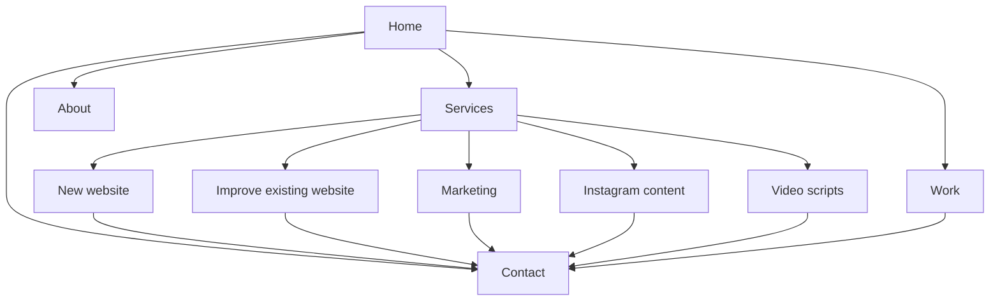

# Freelance Services Website — Product Requirements Document

> Current implementation update — 6 October 2026: the preview now uses ManaCircle, the approved cream/green refinement and ten services. Android apps, Meta Ads, logo/brand identity, QR menus and Telugu content/voiceovers extend the original scope below. See [current service catalogue](../SERVICE-CATALOGUE.md), [visual refinement](../DESIGN-REFINEMENT.md) and [implementation status](../IMPLEMENTATION.md). Contact details remain unconfigured; the project brief downloads locally. The original research is retained as the decision record.

Version: 0.1 — research-backed planning draft  
Research date: 6 October 2026  
Business name: not decided; the workspace name is not treated as the brand name.  
Team: eight members · Design: clean, professional, premium · Target launch: 31 October 2026

Related documents: [Feature list](02-FEATURE-LIST.md), [Design brief](03-DESIGN-BRIEF.md), [Implementation plan](04-IMPLEMENTATION-PLAN.md).

## 1. Product direction

Create an English-language website that helps businesses across India understand and enquire about the owner's website, marketing, Instagram, and content services. Andhra Pradesh and Telangana are included in the service area. The audience can include businesses from any sector; examples on the website should make that broad offer understandable.

The recommended product is a service business website with a portfolio and enquiry journey. A freelancer marketplace with seller accounts, bidding, commissions, and escrow is outside this brief.

**Proposed positioning:** “Websites, marketing and content for your next stage of business.”

**Proposed supporting copy:** “Launch a website, improve the one you have, or get help with campaigns, Instagram content and video scripts.”

The site should explain concrete deliverables and demonstrate the owner's work. Revenue, rankings, follower counts, and virality must not be promised as guaranteed results.

### Telugu quick read

India motham businesses kosam English website. Kotha website kavalsina vallaki design services; already website unna vallaki improvements, ads, marketing; Instagram posts/reels mariyu video scripts services chupistamu. Main purpose: services ardham avvali, work samples chudali, enquiry cheyyali.

## 2. Confirmed requirements and open decisions

### Confirmed by the owner

| ID | Requirement |
| --- | --- |
| C01 | The business offers website design services. |
| C02 | Existing website clients can receive website improvements intended to support leads and sales. |
| C03 | Ads and marketing are also offered to help existing website clients acquire leads and sales. |
| C04 | Instagram posts and reels are part of the offer. |
| C05 | Content writing for videos, including scripts, is part of the offer. |
| C06 | Businesses across sectors are welcome; service coverage includes AP, Telangana, and all India. |
| C07 | Public website content will be in English. |
| C08 | Current work is research and four Markdown planning documents. Website implementation is a later task. |
| C09 | Booking flow: WhatsApp or enquiry, followed by discussion and a custom quotation. |
| C10 | Video/content offer includes scripts, editing client-supplied footage, and creating posts/reels. On-location shooting is not included in the current scope. |
| C11 | The team has eight members. Individual roles and available capacity remain to be defined. |
| C12 | Business name is not decided. No logo or business Instagram account exists yet. |
| C13 | Portfolio/work samples still need to be prepared. |
| C14 | The desired visual style is clean, professional, and premium. |
| C15 | Target launch: 31 October 2026. Website budget is not yet set. |
| C16 | Client scripts are offered in English and Telugu; the website itself remains English. |
| C17 | Ads, including Meta Ads as discussed, are scoped to client requirements. Instagram posting is also available when the client requests it. |

### Decision register — recommendations are not owner commitments

| ID | Current decision/status | Working recommendation | Implementation effect |
| --- | --- | --- | --- |
| D01 | Brand name, domain, business identity | Use a neutral placeholder in planning | Logo, copy, metadata, contact details |
| D02 | Resolved: booking model | Owner chose enquiry → discussion → custom quotation | No public checkout in the current scope |
| D03 | Scripts, client-footage editing, posts/reels confirmed; posting optional per client | Specify production quantities, review rounds, publishing and account permissions in each quotation | DMs/comments and full account management are separate, unconfirmed services |
| D04 | Logo/account absent; samples need preparation | Prepare a wordmark and labelled concept work; omit inactive social links | Branding and sample production are launch tasks |
| D05 | Eight members confirmed; roles and capacity open | Assign responsibility and promise only confirmed capacity | Turnaround, response hours, service availability |
| D06 | Launch target 31 October 2026; budget still open | Use the dated schedule and effort/cost worksheet | Scope and hosting choices |
| D07 | Clean, professional, premium confirmed | Warm professional studio treatment proposed | Palette and typography remain design proposals |
| D08 | Ongoing content editor and technical preference | Developer-maintained content for the first release | CMS and technology choice |
| D09 | Ads scoped to client requirements; Meta Ads discussed | Confirm each chosen channel; Google Ads/SEO are not blanket inclusions; separate advertising spend | Accurate marketing copy and client quotations |
| D10 | Business email/WhatsApp number and response owner | One monitored enquiry inbox plus WhatsApp fallback | Conversion launch readiness |

Discovery answers are reflected above. Brand naming is a future task, not an unanswered factual question. Remaining operational decisions should be resolved where they affect design or implementation, without asking the owner to repeat confirmed answers.

## 3. Research method and limits

Research combines seven service-provider references with official platform, accessibility, search, performance, and implementation documentation: 20 cited references in total. The provider sample includes local studios, larger Indian agencies and international creative services. Sources were inspected through web search and page text. This is a comparison of public messaging, service structure, and enquiry patterns; it is not a visual browser audit or evidence of competitors' actual conversion rates.

Provider claims about revenue, client counts, rankings, and campaign performance were not independently verified and are not used as business benchmarks. No paid keyword-volume dataset, customer interviews, or market-size study was available. Price recommendations below are packaging decisions, not market-average estimates.

### Provider comparison

| Reference | Observed on its public site | Useful implication for this website | Boundary |
| --- | --- | --- | --- |
| [aRa Digital Agency](https://www.aradigitalagency.com/) | Separate website, ads, social, and video services; consultation and WhatsApp entry points | Explain each offer and provide an easy conversation path | Its service list does not establish this owner's capabilities |
| [ShootOrder](https://www.shootorder.com/) | Service navigation, case studies, consultation CTA, and process explanation | Link service claims to relevant work and a clear next step | Do not borrow its badges or reported performance figures |
| [VisionWeb](https://www.visionweb.in/) | Discusses written scope, project/retainer arrangements, and handover | Clarify what clients receive and how an engagement works | Its prices, timelines, and ownership terms are not ours |
| [ManyPixels](https://www.manypixels.co/pricing) | Packages distinguish daily output and service availability | If retainers are introduced, describe capacity and included formats | Do not promise unlimited production or copy its subscription model |
| [Superside video production](https://www.superside.com/video-production) | Separates concepts, shooting, editing, and broader production | Reels and video services need explicit production boundaries | Enterprise production operations are not an MVP requirement |
| [Social Beat](https://www.socialbeat.in/social-media-marketing/) | Organises social work into planning, execution and optimisation; enquiry asks about services and budget | Explain content as a repeatable service and qualify leads | Its long enquiry form is not evidence that our short form needs the same fields |
| [Schbang media solutions](https://www.schbang.com/solutions/media-solutions) | Gives paid-media work its own service explanation | Keep campaign work distinct from content production | Broader enterprise media services are not automatically in our offer |

### Research conclusions translated into decisions

1. **Group services by the client's need.** New website, existing website improvement, customer acquisition, Instagram content, and video writing are five understandable entry points. This is our synthesis of the provider comparisons, not a measured ranking factor.
2. **Use the confirmed enquiry conversion model.** Website and marketing scope varies substantially. A discussion lets the owner quote against deliverables before taking payment. The owner selected this approach.
3. **Show proof early.** Work examples can make abstract creative services tangible. Where client work is unavailable, use clearly labelled self-initiated examples and describe the design decisions without invented results.
4. **Separate creation from distribution.** Scripts, footage, editing, publishing, account management, and ad spend are different responsibilities. The service pages and quotations must say which are included.
5. **Design for phone use and restrained media.** Reels samples should be easy to view without downloading a background showreel on every visit. This is a project design recommendation supported by the performance goals below.

### Search and content opportunity hypotheses

These are page-intent ideas, not keyword-volume findings or guaranteed ranking opportunities.

| Customer intent | Proposed destination | Content that should answer it |
| --- | --- | --- |
| Need a business website | Website design page | Scope, page types, mobile examples, ownership, enquiry |
| Existing site gets few enquiries | Website improvement page | Review process, examples of fixes, measurement approach |
| Need marketing help | Digital marketing page | Supported channels, creative responsibilities, reporting, ad budget distinction |
| Need regular Instagram content | Instagram page | Format examples, calendar, creation/publishing boundaries |
| Need scripts for reels or videos | Content and scripts page | Writing samples, language, intended length, revision scope |

Use helpful, specific content and descriptive page titles. Do not create near-identical city pages to imply offices or experience the business does not have. [Google SEO Starter Guide](https://developers.google.com/search/docs/fundamentals/seo-starter-guide)

## 4. Customers and their tasks

The following are planning personas, not research participants. They illustrate the owner's broad business audience.

| Persona | Situation | Needs to know | Desired action |
| --- | --- | --- | --- |
| Business owner starting online | Has a business and perhaps an Instagram profile, but no useful website | What is included, who provides copy, what ownership means | Enquire about a website |
| Owner with an existing site | Has traffic or a site but too few useful enquiries | Whether the team can review and improve the site and campaigns | Share a public website URL and describe the problem |
| Brand/content manager | Needs consistent posts, reels, or video writing | Formats, quality, revision limits, footage responsibilities | View samples and discuss a content plan |

All journeys should work without requiring an account or a marketing opt-in.

## 5. Service catalogue

| ID | Public service | Proposed deliverables to confirm | Important exclusions or dependencies |
| --- | --- | --- | --- |
| S01 | Website Design & Development | Discovery, page structure, responsive design/build, enquiry integration, basic search setup, handover | Page count, copywriting, domain/hosting, e-commerce, ongoing maintenance separately scoped |
| S02 | Website Improvement | Review existing site, prioritised recommendations, agreed design/content/performance/contact-flow fixes | Requires platform/access assessment; no automatic rebuild or sales guarantee |
| S03 | Digital Marketing | Campaign plan and ads selected for the client's requirements, including Meta Ads when appropriate; creative coordination and reporting | Media spend separate from service fee; Google Ads, SEO and wider account management need explicit capability/scope agreement |
| S04 | Instagram Posts & Reels | Scripts, post designs, captions, client-footage editing; Instagram posting available on request | Shooting excluded; publishing quantities/timing must be quoted; DMs/comments and paid promotion are separate |
| S05 | Video Scripts & Content Writing | English/Telugu hooks, script structure, narration copy, captions/CTA where scoped, revisions | Editing is scoped under S04; shooting, voiceover and specialist factual review are separate; other languages not assumed |

For every service, publish the buyer problem, deliverables, client inputs, scope limits, working process, suitable examples, and enquiry CTA. English/Telugu script delivery is a confirmed service capability; it does not add a Telugu version of the website.

### Proposed engagement types

- **Website project:** defined pages, functionality, revision rounds, launch/handover, and optional maintenance.
- **Website improvement project:** review followed by a quoted list of changes; agree a baseline before measuring outcomes.
- **Monthly marketing/content support:** agreed channels, deliverable counts, approval dates, reporting, and production limits.
- **Script/content batch:** quantity, intended duration/word range, research requirements, language, revisions, and delivery format.

Launch with “Request a quote,” matching the owner's selected booking model. Before quoting, distinguish service fees, advertising spend, hosting/domain, paid assets/tools, any separately requested production costs, and applicable taxes. No numerical package price is approved in this document.

## 6. Information architecture

Recommended first release: 11 public routes plus success and error states. Shared templates reduce implementation effort.

| Route | Purpose |
| --- | --- |
| `/` | Positioning, service choice, work preview, process, FAQ, contact CTA |
| `/services` | Compare all five services and engagement options |
| `/services/website-design` | S01 detail |
| `/services/website-improvement` | S02 detail |
| `/services/digital-marketing` | S03 detail |
| `/services/instagram-content` | S04 detail |
| `/services/content-writing` | S05 detail |
| `/work` | Approved work samples or clearly labelled concept projects |
| `/about` | Real people, capabilities, working approach, service coverage |
| `/contact` | Short brief, enquiry form, direct contact alternatives |
| `/privacy` | Accurate notice reflecting the selected tools and actual data handling |

Utility routes: `/thank-you` and a genuine 404 page. Keep the thank-you route out of search indexing. A direct visit to it does not count as a submitted lead.

Optional later routes: individual case studies, packages, articles. If budget requires a smaller launch, consolidate service detail sections into `/services` explicitly; do not leave empty routes or placeholder links in production.

## 7. Main customer journeys

### New website

Visitor opens Home → chooses Website Design → reads scope and sees a relevant sample → opens Contact with the service preselected → submits a brief → receives an honest acknowledgement → owner qualifies and quotes.

### Improve an existing website

Visitor opens Website Improvement or Digital Marketing → recognises their problem → understands that both site improvements and acquisition support are available → optionally supplies a public URL → requests a discussion. No passwords or account access are collected in the public form.

### Instagram or script work

Visitor views examples → checks deliverables and production responsibilities → selects content service → shares goal and preferred contact method. During discussion, confirm English/Telugu, client footage, and whether publishing is requested. Asset collection and account invitations happen after scoping, through an agreed channel.

### Direct WhatsApp

Visitor chooses WhatsApp → opens a chat with a generic, editable service enquiry. A link click is an intent signal, not proof that a message was sent. Provide an email/contact-page fallback. [WhatsApp click-to-chat guidance](https://faq.whatsapp.com/5913398998672934)

## 8. Functional and operational requirements

Detailed, testable requirements are in the [feature list](02-FEATURE-LIST.md).

- Service and work links must lead to complete, relevant content.
- Keep the first enquiry short: name, service, preferred contact channel, the corresponding contact detail, and a brief. Optional fields can capture business, public URL, budget band, and target date.
- A form must show success only after the receiving service reports acceptance. Verify that test enquiries are retrievable by the owner before launch.
- Preserve input after recoverable submission errors. Do not present an email draft or WhatsApp click as a stored enquiry.
- Public enquiries need spam protection and restricted owner access. Retention, deletion, and contact handling must have an assigned owner.
- Every publicly advertised quantity, turnaround, free consultation, and revision allowance needs owner confirmation.
- Content must remain editable through the chosen maintenance approach; a custom admin application is unnecessary for the initial scope.

## 9. Quality requirements

| Area | Acceptance target |
| --- | --- |
| Mobile | All core journeys usable from 320 CSS px width; no accidental horizontal scrolling |
| Accessibility | Target WCAG 2.2 AA; verify keyboard operation, labels, focus, errors, captions, and contrast |
| Performance | Aim for LCP ≤2.5 s, INP ≤200 ms, CLS ≤0.1 at the 75th percentile when sufficient field data exists |
| Search | Crawlable useful content, unique titles, appropriate canonical URLs, sitemap and social previews |
| Reliability | Form acceptance/retrieval, failure handling, contact fallback, and owner follow-up tested |
| Trust | Approved claims and work permissions; concept projects clearly labelled |
| Privacy | Necessary enquiry data only; no personal form content in analytics or public URLs |

Performance thresholds follow [web.dev](https://web.dev/articles/vitals). A prelaunch lab score is not a field-performance pass. Accessibility requirements draw on [W3C contrast](https://www.w3.org/WAI/WCAG22/Understanding/contrast-minimum.html) and [target-size guidance](https://www.w3.org/WAI/WCAG22/Understanding/target-size-minimum.html); an automated scan alone cannot establish conformance.

## 10. Measurement and success

**Primary business measure:** qualified enquiries that the owner can actually respond to.

A qualified enquiry has reachable contact information, a requested service the business offers, and enough context to discuss scope. Budget readiness and timing are recorded during qualification, not assumed from a click.

| Measure | Definition | Source |
| --- | --- | --- |
| Accepted form enquiries | Submissions acknowledged by the receiver and available in its records | Lead inbox/provider |
| Contact intent | WhatsApp, email, or phone link clicks | Optional consent-aware analytics |
| Qualified enquiries | Owner-reviewed leads meeting the above definition | Private lead tracker |
| Proposal rate | Proposals sent ÷ qualified enquiries in the same cohort | Private lead tracker |
| Win rate | Won projects ÷ proposals with a recorded decision | Private lead tracker |
| Response time | Time from accepted enquiry to first human response during declared hours | Lead tracker |

Exclude spam and internal tests. Deduplicate enquiries before business reporting. Establish a baseline during the first 30 days; review at 60 and 90 days. Do not set a promised sales uplift or conversion benchmark without traffic and business data. If analytics is absent or declined, use aggregate lead records and acknowledge the missing visitor denominator.

## 11. Scope boundaries and risks

Out of the recommended first release: marketplace features, public accounts, client portal, checkout/subscriptions, an automated social scheduler, AI chatbot, custom CRM, and large-scale article production.

| Risk | Effect | Response |
| --- | --- | --- |
| Broad business audience | Generic messaging | Use concrete problems and varied examples; allow every sector to enquire |
| Portfolio unavailable | Weak evidence | Create honest concept samples and show process; omit invented reviews |
| Name/logo and samples still to be created | Compresses the October schedule | Assign early owners and use the 13 October scope checkpoint in the implementation plan |
| Production responsibilities unclear | Rework and pricing disputes | Confirm filming/editing/publishing before advertising them |
| Ads confused with service fees | Unclear commercial expectations | Explain budget components in service and proposal copy |
| Unmonitored contact channel | Missed opportunities | Assign one owner and a realistic response window |
| Heavy video | Slow mobile pages | Static posters, on-demand playback, compressed media |
| Overbuilding administration | Delayed launch | Use existing lead/content tools before custom systems |

## 12. Launch acceptance

- [ ] Brand, contact channels, service descriptions, and production boundaries confirmed.
- [ ] All agreed public routes contain final English content and approved assets.
- [ ] A visitor can identify the right service, view relevant proof, and enquire from a phone.
- [ ] Enquiry success, validation, spam handling, failure, and owner retrieval verified.
- [ ] Direct contact alternatives work on mobile and desktop.
- [ ] Claims, sample labels, privacy notice, and any prices match the business's real operation.
- [ ] Search, accessibility, and performance checks have recorded results and unresolved issues.
- [ ] The owner can retrieve leads, update content through the selected process, and request rollback.

## 13. Source register

All checked on 6 October 2026. Links support their associated observations, not endorsement of a vendor.

| ID | Source | Use and access notes |
| --- | --- | --- |
| R01 | [aRa](https://www.aradigitalagency.com/) | Local service structure and contact patterns; page text inspected |
| R02 | [ShootOrder](https://www.shootorder.com/) | Service navigation, work, process, enquiry; page text inspected |
| R03 | [VisionWeb](https://www.visionweb.in/) | Scoping, handover, engagement explanations; page text inspected |
| R04 | [ManyPixels pricing](https://www.manypixels.co/pricing) | Capacity-based packaging; not used as an Indian price benchmark |
| R05 | [Superside video services](https://www.superside.com/video-production) | Separation of video production stages |
| R06 | [Meta Reels ads](https://www.facebook.com/business/ads/facebook-instagram-reels-ads) | Vertical creative, audio and safe zones; no performance uplift copied |
| R07 | [Instagram music guidance](https://www.facebook.com/help/instagram/402084904469945) | Official indexed excerpt; full page redirected to login, so licensing must be rechecked for each use |
| R08 | [WhatsApp click to chat](https://faq.whatsapp.com/5913398998672934) | Official indexed guidance; page body not returned by the text tool |
| R09 | [W3C contrast](https://www.w3.org/WAI/WCAG22/Understanding/contrast-minimum.html) | Text contrast criteria |
| R10 | [W3C target size](https://www.w3.org/WAI/WCAG22/Understanding/target-size-minimum.html) | Minimum target size and exceptions |
| R11 | [Web Vitals](https://web.dev/articles/vitals) | Performance targets and field measurement |
| R12 | [Google SEO Starter Guide](https://developers.google.com/search/docs/fundamentals/seo-starter-guide) | Useful content and search foundations |
| R13 | [Why Astro](https://docs.astro.build/en/concepts/why-astro/) | Content-oriented implementation option |
| R14 | [Netlify Forms setup](https://docs.netlify.com/manage/forms/setup/) | Managed form option |
| R15 | [Netlify submissions](https://docs.netlify.com/manage/forms/submissions/) | Owner inbox, exports and deletion |
| R16 | [Next.js static exports](https://nextjs.org/docs/app/guides/static-exports) | Static hosting and runtime limitations |
| R17 | [WordPress Site Editor](https://wordpress.org/documentation/article/site-editor/) | Owner-editable CMS option |
| R18 | [Netlify spam filters](https://docs.netlify.com/manage/forms/spam-filters/) | Form spam handling option |
| R19 | [Social Beat social media](https://www.socialbeat.in/social-media-marketing/) | Indian agency service process and enquiry qualification |
| R20 | [Schbang media solutions](https://www.schbang.com/solutions/media-solutions) | Paid-media service positioning |

This document is complete as a planning draft. Open owner decisions are explicit and must not silently become published claims or production purchases.
