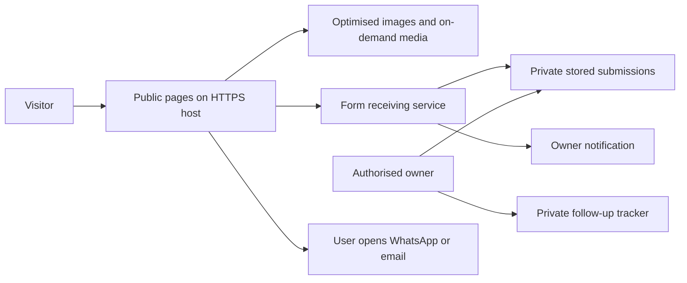

# Freelance Services Website — Implementation Plan

> Current implementation update — 6 October 2026: the preview now uses ManaCircle, the approved cream/green refinement and ten services. Android apps, Meta Ads, logo/brand identity, QR menus and Telugu content/voiceovers extend the original scope below. See [current service catalogue](../SERVICE-CATALOGUE.md), [visual refinement](../DESIGN-REFINEMENT.md) and [implementation status](../IMPLEMENTATION.md). Contact details remain unconfigured; the project brief downloads locally. The original research is retained as the decision record.

Version: 0.1 — planning only, 6 October 2026  
Target launch: 31 October 2026  
Team size: eight people; individual roles and availability still to be confirmed  
Budget: not set  
Brand name: not decided; logo, business Instagram account and work samples still to be created

Related documents: [PRD and source register](01-PRD.md), [Feature list](02-FEATURE-LIST.md), [Design brief](03-DESIGN-BRIEF.md).

## 1. Delivery outcome

Deliver an English service website for businesses across India, showing five service areas, credible work samples, and the confirmed WhatsApp/enquiry → discussion → custom quotation journey.

This plan describes future work. The current task creates planning documents only. No application, domain, social account, hosting resource, payment service, or live lead integration has been created.

### Recommended first release

- Eleven public routes from the PRD, built with shared layouts and a reusable service template.
- A work gallery, with real projects or clearly labelled concepts.
- A short enquiry form with a private receiving inbox and direct WhatsApp/email alternatives.
- Search foundations, accessible interactions, restrained media, and a documented content-maintenance path.
- A simple private lead tracker for follow-up; no custom CRM or customer accounts.

## 2. Decisions before implementation

| Decision | Current state | Needed by | Effect |
| --- | --- | --- | --- |
| Business name | Not decided | Identity finalisation | Brand, domain, copy, metadata |
| Public contact channels | Not supplied | Enquiry integration | Email/WhatsApp verification and lead ownership |
| Work examples and permissions | Samples need preparation | Work-page design | Schedule original concept samples and rights checks |
| Marketing channels and content languages | Ads per client requirement; English/Telugu scripts confirmed | Service copy finalisation | Quote exact channels; prepare examples in both languages |
| Publishing/account management | Instagram posting optional per client request; full management not confirmed | Instagram service copy finalisation | Quote publishing/approval responsibilities without promising DMs/comments |
| Team responsibilities/availability | Eight people confirmed | Schedule commitment | Capacity and realistic turnaround |
| Technology/editor preference | Not specified; no existing app found | Build setup | Framework and maintenance model |
| Hosting/form budget and data preferences | Not set | Integration selection | Provider, quotas, retention and ongoing costs |
| Response window and quotation process | Journey confirmed; timing not set | Contact copy | Public expectations and operating process |

These decisions do not block the research or draft documents. Resolve the relevant ones before implementing their dependent features. A missing Instagram account does not prevent website launch if its link is omitted.

## 3. Technology options

Technology is selected for this project's content, editing needs, and team skills. No infrastructure purchase is implied by a recommendation.

| Option | Fit | Tradeoff | Choose when |
| --- | --- | --- | --- |
| Astro + TypeScript + structured content + managed forms | Mostly static service pages and portfolio | Developer-led updates unless a CMS is added | Recommended baseline if the team is comfortable maintaining code |
| Next.js + TypeScript | React-skilled team or a credible future need for richer application features | Rendering/runtime choices require care; a static export cannot handle dynamic server work itself | Prefer if existing team expertise makes delivery faster |
| Managed WordPress with a block theme | Frequent owner editing through a CMS | Theme/plugin updates, backups and performance need continuing attention | Prefer if nontechnical editing is a launch requirement |

Astro explicitly targets content-oriented sites. Next.js supports static exports but documents limitations for features requiring a server. WordPress's Site Editor uses block themes. These establish capabilities, not a guarantee of cost or speed. [Astro](https://docs.astro.build/en/concepts/why-astro/), [Next.js](https://nextjs.org/docs/app/guides/static-exports), [WordPress](https://wordpress.org/documentation/article/site-editor/)

**Recommendation:** use the smallest content-site approach the team already knows. Astro is a provisional fit for the stated scope; if the developer is already productive in Next.js, using Next.js is preferable to learning a new framework solely for this launch. Confirm the choice during setup. Do not build multiple implementations.

### Hosting and forms

A static host with managed form handling is a practical candidate. Netlify documents form detection, submission management, exports/deletion and spam filtering. It is an example to evaluate, not a selected account or a free-service promise. [Forms setup](https://docs.netlify.com/manage/forms/setup/), [Submissions](https://docs.netlify.com/manage/forms/submissions/), [Spam filtering](https://docs.netlify.com/manage/forms/spam-filters/)

Before selection, check current cost, limits, ownership, data location/retention, deletion/export, spam tools, request restrictions, response semantics and delivery notifications. If the provider cannot meet agreed data or validation needs, scope a small server-side form receiver with durable storage; revise effort explicitly.

A separate multi-service backend, cache and job system are not required by this brochure-and-enquiry scope. Static hosting still needs a real receiving service for form submissions. Browser-only mock success is not acceptable.

## 4. Proposed architecture



The notification is not the sole lead record. Public pages never expose an administrative inbox credential. WhatsApp leads enter the business's conversation flow; clicks alone do not establish receipt or a sales opportunity.

### Suggested project structure after setup

Adapt names to the selected framework; this is a responsibility map, not files created by this planning task.

```text
site/
  pages-or-routes/       home, services, work, about, contact, privacy, errors
  components/           header, footer, service row, work item, media, form
  content/
    services/           five structured service records
    work/               client/concept records with rights and evidence
    business/           approved identity, contact and FAQ content
  styles/               colour, typography, spacing and component tokens
  assets/               approved images, posters and icons
  checks/               focused interaction and link checks
```

Keep contact data in the lead receiver, not in this public content structure. Keep production secrets in the hosting environment. Use synthetic enquiries for testing.

## 5. Content preparation

### Required content pack

1. Brand name, a simple wordmark, domain decision and favicon.
2. Business description, approved team facts and India-wide service statement.
3. Five service records with deliverables, boundaries, inputs and FAQs.
4. A curated work set: ideally a website example, existing-site improvement explanation, post/reel example, and script excerpt. One strong sample can cover more than one related service.
5. Business email/WhatsApp number, monitored inbox and contact response policy.
6. Accurate privacy notice based on actual tools and operations.

The owner confirmed samples still need preparation. Allocate an initial concept-sample sprint and label each example before design review; do not create fictional clients, reviews or measured outcomes.

| Sample | Proposed output | Suggested owner | Purpose |
| --- | --- | --- | --- |
| Business website concept | One desktop and one mobile key-page design for a fictional business | UI designer | Demonstrate website capability without building a second full website |
| Website improvement concept | Annotated before/after of an original demo page | Designer + web developer | Show improvements in clarity, mobile layout and enquiry flow without fabricated sales numbers |
| Instagram content concept | Two posts and one short edited reel using approved demonstration footage | Social designer + video editor | Demonstrate the client-footage editing workflow |
| Script concept | An English script and a Telugu script for a simple fictional campaign | Content writer | Demonstrate the confirmed bilingual writing service |

These are sample-production tasks for implementation, not artifacts already made by this research task. Keep them modest to fit the October launch; an extensive portfolio needs a separate production estimate.

### Production scope for Instagram/video content

The owner confirmed English/Telugu scripts, editing client-supplied footage, and creating posts/reels. Prepare one complete demonstration with brief → script → edited reel → caption. State what the client supplies and what the team delivers. Shooting is outside the current offer. Instagram posting can be included when requested, with approval dates and publishing responsibilities in the quotation; full account/DM management is not assumed.

Every creative sample needs a publication-rights check, including footage, music, stock, people and logos. This is part of asset preparation, not permission to publish a client's private files.

## 6. Phases and exit criteria

| Phase | Work | Exit criteria | Features covered |
| --- | --- | --- | --- |
| A — Scope and identity | Resolve open business questions, choose name/approach, assign owners | A usable business brief and realistic launch scope | All |
| B — Copy and proof | Draft English service/FAQ/team content; curate or produce samples | Content ready for design, asset permissions recorded | F02–F09 |
| C — Design | Home/service/contact wireframes; mobile layouts; visual tokens and states | Clear responsive direction matching premium preference | F01–F12, F15 |
| D — Build public pages | Shared layout, five service pages, work, about, privacy and utility pages | All routes render final content and link correctly | F01–F09, F14, F18, F20 |
| E — Enquiry and operations | Configure receiver, WhatsApp, failure states, spam handling, lead ownership | Accepted synthetic lead is retrievable; fallback works | F10–F13, F17, F19 |
| F — Verify and refine | Mobile, keyboard, media, links, search metadata, performance, copy accuracy | No unresolved issue that blocks understanding or enquiry | F14–F20 |
| G — Launch and handover | Production setup, final smoke checks, owner training, rollback record | Owner can retrieve leads and maintain content | All P0 |

## 7. Schedule toward 31 October 2026

Dates are a proposed working schedule from the current planning date, not a promise that eight people are available full-time. Content and design can overlap where inputs are ready.

| Dates | Target | Dependency / decision |
| --- | --- | --- |
| 7–9 Oct | Name shortlist/selection, scope, role allocation, technology and cost decisions | Owner responses and team availability |
| 9–13 Oct | Brand basics, service copy, work samples and wireframes | Name and actual capabilities |
| 13–15 Oct | Final visual direction and reusable page/component design | Copy and representative media |
| 15–22 Oct | Build public routes and integrate enquiry flow | Selected host/receiver and business contact |
| 23–26 Oct | Real-device checks, accessibility, performance, content and form verification | Complete production-like preview |
| 27–28 Oct | Owner review, fixes, content freeze | All launch content supplied |
| 29–30 Oct | Buffer, production preparation, handover and smoke checks | No unresolved launch blockers |
| 31 Oct | Target launch | Passing checks and operational contact channels |

**Checkpoint on 13 October:** if the name, core copy or usable samples are still missing, reduce the first release to Home, Services with five complete sections, Work, About, Contact and Privacy. Retain the enquiry journey and quality requirements. Move separate service URLs into the immediate next iteration and adjust sitemap/copy consistently. This is a proposed contingency to agree with the owner, not an automatic scope reduction.

## 8. Suggested allocation for the eight-person team

These are responsibilities to assign, not assumptions about individual expertise. People may cover more than one role, and specialist work may require help.

| Seat | Primary responsibility | Deliverable |
| --- | --- | --- |
| 1 | Business/project lead | Name/scope decisions, priorities, approvals, launch coordination |
| 2 | Brand/UI designer | Wordmark, wireframes, visual system, assets |
| 3 | Web developer | Site implementation, deployment setup, form integration |
| 4 | Content writer | English pages/FAQs plus English and Telugu script samples; proofreading |
| 5 | Video editor | Footage review, reel example, poster, captions, export |
| 6 | Graphic/social designer | Post examples and reusable content presentation |
| 7 | Marketing/search specialist | Per-client channel scope, optional publishing process, search content review and measurement definition |
| 8 | QA/client-operations owner | Device checks, enquiry verification, lead follow-up process |

Confirm one accountable owner for accepted leads and one backup. A team count alone is not a public capacity or turnaround guarantee.

## 9. Effort and cost planning

These are internal planning estimates, not vendor quotations or researched market rates. They assume shared templates, one language, a modest sample gallery, a managed receiver and prompt decisions.

| Workstream | Estimated person-hours |
| --- | --- |
| Scope and setup decisions | 8–12 |
| Copy and a modest initial set of concept samples | 24–36 |
| Identity basics and UI design | 20–28 |
| Public-page implementation | 36–52 |
| Enquiry integration and operations | 12–20 |
| Quality checks and fixes | 16–24 |
| Handover and launch preparation | 4–8 |
| **Total** | **120–180** |

Major logo exploration, original filming, extensive new concept work, a custom server, checkout, large animation work or multiple languages require re-estimation. Calendar time depends on actual availability and feedback; do not divide the total by eight and assume the result is the delivery duration.

### Budget worksheet

| Item | Cost type | Decision |
| --- | --- | --- |
| Domain | Renewal expense | Check chosen name and renewal rate |
| Hosting/form handling | Recurring or usage-based | Verify provider plan and expected usage |
| Business email | Recurring if paid provider used | Confirm mailbox ownership and staffing |
| Design/development/content | Team time or project fee | Use the effort range and actual rates |
| Fonts/stock/music | Licence-dependent | Prefer approved existing/original assets; verify intended use |
| Maintenance | Team time/retainer | Assign update, backup and lead-monitoring ownership |
| Client advertising campaigns | Separate client expense | Not part of the agency website build budget |

No price or subscription has been selected. Compare total first-year cost, renewals and operational effort before purchasing. Do not call a plan “free forever” based on current introductory limits.

## 10. Enquiry integration checklist

1. Implement the fields and contact-method rules in the feature list.
2. Ensure the receiver recognises the deployed form and permits the intended origin/setup.
3. Configure spam checks and reasonable length/request restrictions using supported provider capabilities.
4. Guard repeated browser submissions. If strict server-side deduplication is unavailable, document the limitation and handle duplicate records operationally.
5. Show success only after acknowledgement; preserve the brief on rejection, timeout or connection loss.
6. Retrieve a synthetic test enquiry from the owner's account. Check spam quarantine as well as normal inbox routing.
7. Verify notification delivery, and confirm records remain available if notification fails.
8. Confirm export/delete operations and access permissions in the chosen receiver.
9. Test the WhatsApp number and fallback without sending unsolicited messages to clients.
10. Document who checks new leads, how quickly they respond, and where quotations are tracked.

If a custom receiver is selected, implement server-side field validation, restricted administrative access, durable acceptance, safe logging and abuse limits. That choice adds engineering and maintenance work beyond merely creating a static form.

## 11. Verification plan

Use checks appropriate to a public service website. Record actual results and remaining limitations rather than implying a design plan has passed runtime tests.

| Check | Method | Required evidence |
| --- | --- | --- |
| Page completeness | Review every agreed route and service entry | No placeholders, fabricated claims or broken navigation |
| Contact journeys | Browser test plus receiver readback using synthetic data | Correct service selection, acceptance and retrievable record |
| Failure handling | Simulate unavailable receiver and timeout | Preserved input, honest state, working fallback |
| Input rules | Invalid email/phone, blank brief, long input, contact-method switch | Correct client behaviour and documented receiver constraints |
| Media | Slow connection, missing video, keyboard playback | Readable poster/text fallback, controls and captions |
| Mobile | Android Chrome and iPhone Safari where devices are available | No overflow or obscured actions; note any untested platform |
| Accessibility | Keyboard + screen-reader spot checks and automated scan | Labels, focus, errors, contrast and captions reviewed |
| Search/share | Metadata, robots, sitemap, canonical and preview inspection | Public URLs correct; utility/preview pages handled appropriately |
| Performance | Representative home, service, work and contact lab checks | Conditions and results recorded; field data assessed after launch |
| Owner operations | Owner retrieves a test lead and follows update instructions | Verified handover, lead owner and rollback approach |

Use the PRD's performance goals. A Lighthouse result alone does not prove real-user Core Web Vitals performance. [Web Vitals guidance](https://web.dev/articles/vitals)

For automated tests, focus on contact-method validation, service preselection, success/error handling and critical navigation. Avoid spending launch time on tests that merely duplicate static marketing text.

## 12. Launch and rollback

Before publishing, verify the final domain/contact values, content permissions, privacy notice, form provider, working HTTPS, error handling and social previews. Remove placeholder social links. Confirm production lead access with a synthetic submission and delete the test according to the agreed process.

Keep the previous deploy or an export of the release so the site can be restored if a critical issue appears. If the form breaks, make direct contact alternatives prominent while the receiver is repaired. Do not delete accepted lead records during a site rollback.

Handover should include content-update steps, domain/hosting ownership, form-provider access procedure, renewal responsibilities, asset source/licence records and a simple contact-response process. Deliver credentials through an appropriate private channel, never in public repository documents.

## 13. First 30 days after launch

- Check the receiving inbox and spam folder regularly; record missed or duplicated enquiries.
- Review which services generate useful conversations and which questions repeat.
- Fix ambiguous copy and delivery expectations before adding features.
- Review field performance when enough observations exist.
- Add real work and reviews only with permission.
- Evaluate a CMS, calendar, packages or automation only against a real operational need.

Completion of this plan means the team has a buildable, scoped direction with explicit open decisions. The production website itself is a future implementation deliverable.
